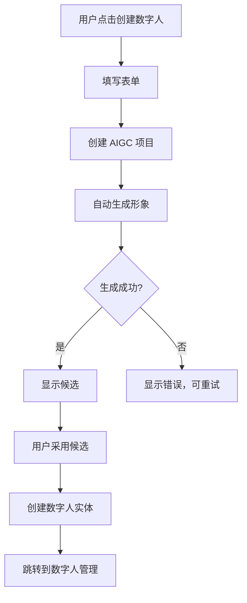
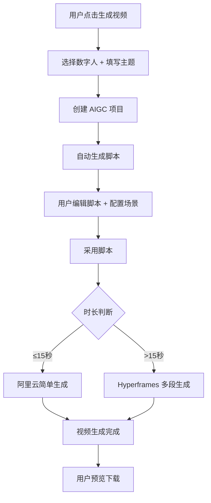

# 数字人系统产品需求文档（PRD）

**版本**: v1.0  
**日期**: 2026-09-22  
**产品经理**: Kiro  
**状态**: 待评审

---

## 一、产品概述

### 1.1 产品定位

数字人系统是一个 AI 驱动的数字人资产管理与营销视频生成平台，帮助企业和创作者快速创建、管理数字人形象，并生成营销视频内容。

### 1.2 目标用户

- **营销人员**：需要快速生成产品宣传、活动推广视频
- **内容创作者**：需要批量生成教程、讲解视频
- **企业团队**：需要统一的品牌数字人形象
- **客服团队**：需要数字人客服形象和话术视频

### 1.3 核心价值

- **降低成本**：无需真人拍摄，AI 生成数字人视频
- **提高效率**：15 秒视频 < 5 分钟生成
- **统一形象**：企业级数字人资产管理
- **灵活复用**：一个数字人生成多个视频

---

## 二、功能需求

### 2.1 模块一：数字人资产生成

#### 功能描述

用户通过 AIGC 项目流程创建数字人资产，包括形象和音色。

#### 用户故事

**US-101**: 作为营销人员，我想通过文字描述生成数字人形象，以便快速获得符合品牌调性的数字人。

**验收标准**：
- ✅ 用户可以输入形象描述（如："25岁职业女性，短发，商务装"）
- ✅ 可选上传参考图片
- ✅ 可选择 5 个预设音色之一
- ✅ 提交后创建 AIGC 项目
- ✅ 生成形象后显示在项目详情页
- ✅ 采用形象后自动创建数字人实体

**US-102**: 作为用户，我想在生成数字人时看到多个候选形象，以便选择最满意的。

**验收标准**：
- ✅ 形象生成后显示候选列表
- ✅ 可以重新生成更多候选
- ✅ 采用一个候选后，其他候选归档
- ✅ 采用后项目状态变为已完成

#### 交互流程

```
1. 用户点击"创建数字人"
   ↓
2. 跳转到 AIGC 项目创建页面
   - Blueprint: "数字人资产生成"
   ↓
3. 填写表单：
   - 项目名称（必填）
   - 形象描述（必填）
   - 参考图片（可选）
   - 选择音色（必填，默认"艾佳"）
   ↓
4. 点击"创建项目"
   ↓
5. 进入项目详情页
   - 显示对象：avatar_image (EMPTY)
   - 自动开始生成
   ↓
6. 生成完成
   - 显示候选形象（卡片视图）
   - 每个候选显示预览图
   ↓
7. 用户操作：
   - [采用] 选择一个候选
   - [重新生成] 生成更多候选
   - [编辑提示词] 修改描述重新生成
   ↓
8. 采用后
   - 显示"项目已完成"
   - 提示"数字人已创建"
   - [前往数字人管理] 按钮
```

#### UI 设计要点

**项目创建表单**：
```
┌────────────────────────────────────────┐
│ 创建数字人                    [× 关闭]  │
├────────────────────────────────────────┤
│                                        │
│ 项目名称 *                              │
│ ┌────────────────────────────────────┐ │
│ │ 职业女性 A                          │ │
│ └────────────────────────────────────┘ │
│                                        │
│ 形象描述 *                              │
│ ┌────────────────────────────────────┐ │
│ │ 25岁职业女性，短发，商务装，         │ │
│ │ 温柔微笑，专业形象                   │ │
│ └────────────────────────────────────┘ │
│ 💡 提示：描述越详细，生成效果越好        │
│                                        │
│ 参考图片（可选）                        │
│ ┌────────────────────────────────────┐ │
│ │  [📷 上传图片]                      │ │
│ │  支持 JPG/PNG，最大 10MB             │ │
│ └────────────────────────────────────┘ │
│                                        │
│ 选择音色 *                              │
│ ┌────────────────────────────────────┐ │
│ │ [艾佳 ▼]                            │ │
│ └────────────────────────────────────┘ │
│ [🔊 试听音色]                          │
│                                        │
│ 预计消耗：约 50 积分                    │
│                                        │
│           [取消]  [创建项目]            │
└────────────────────────────────────────┘
```

---

### 2.2 模块二：数字人管理

#### 功能描述

用户可以查看、编辑、删除数字人资产，配置音色和模型，关联助理。

#### 用户故事

**US-201**: 作为用户，我想查看我的所有数字人，以便管理和复用。

**验收标准**：
- ✅ 显示我创建的数字人
- ✅ 显示我组织共享的数字人（标记"组织共享"）
- ✅ 卡片视图展示：头像、名称、音色、使用次数
- ✅ 支持标签筛选
- ✅ 支持关键词搜索（名称、描述）

**US-202**: 作为用户，我想编辑数字人的配置，以便调整音色、模型参数。

**验收标准**：
- ✅ 可以修改名称、描述、标签
- ✅ 可以切换音色（预设列表 + 试听）
- ✅ 可以调整音色参数（语速、音调、音量）
- ✅ 可以配置大模型（选择模型、Temperature、系统提示词）
- ✅ 可以关联助理（下拉选择 + 同步配置）
- ✅ 查看使用统计（视频数、时长、积分）

**US-203**: 作为组织成员，我想使用组织共享的数字人，但不能修改它。

**验收标准**：
- ✅ 可以查看组织共享的数字人详情
- ✅ 可以使用它生成视频
- ✅ 不能编辑、删除（按钮置灰或隐藏）
- ✅ 显示"由 XXX 创建"

**US-204**: 作为用户，我想将数字人关联到助理，以便助理有形象。

**验收标准**：
- ✅ 在数字人详情页选择助理
- ✅ 在助理详情页显示数字人头像
- ✅ 可以从数字人跳转到助理
- ✅ 可以从助理跳转到数字人
- ✅ 可选：同步助理的模型配置到数字人

#### 交互流程

**查看列表**：
```
1. 用户进入"数字人管理"
   ↓
2. 显示卡片列表（默认显示全部）
   ↓
3. 筛选操作：
   - 点击标签：筛选该标签
   - 输入搜索：实时过滤
   - 切换视图：[我的] [组织共享]
   ↓
4. 点击卡片 → 进入详情页
```

**编辑数字人**：
```
1. 在详情页点击"编辑"（或直接进入编辑模式）
   ↓
2. 修改配置：
   - 基础信息
   - 音色配置
     - 点击"切换音色" → 弹出音色选择器
     - 选择音色 → 点击"试听" → 确认选择
     - 调整参数（滑块）
   - 模型配置
   - 关联助理
   ↓
3. 点击"保存"
   ↓
4. 显示保存成功提示
```

**音色切换**：
```
1. 点击"切换音色"
   ↓
2. 弹出音色选择器
   ┌──────────────────────────────────┐
   │ 选择音色              [× 关闭]    │
   ├──────────────────────────────────┤
   │ 预设音色：                        │
   │                                  │
   │ ○ 艾佳 - 温柔亲切  [🔊 试听]     │
   │ ● 艾彤 - 活力甜美  [🔊 试听]     │
   │ ○ 小云 - 知性优雅  [🔊 试听]     │
   │ ○ 艾诚 - 专业沉稳  [🔊 试听]     │
   │ ○ 艾伟 - 温和亲切  [🔊 试听]     │
   │                                  │
   │          [取消]  [确认选择]       │
   └──────────────────────────────────┘
   ↓
3. 点击"试听" → 播放示例音频
   ↓
4. 选择一个音色 → 点击"确认选择"
   ↓
5. 音色更新，关闭弹窗
```

#### UI 设计要点

**列表页（卡片视图）**：
```
┌────────────────────────────────────────────────┐
│ 数字人管理       [+ 创建数字人]                  │
├────────────────────────────────────────────────┤
│ 筛选：[全部] [营销] [客服] [讲师]                │
│ 搜索：[________________] 🔍                    │
│ 视图：[● 全部] [○ 我的] [○ 组织共享]            │
├────────────────────────────────────────────────┤
│                                                │
│ ┌──────────┐  ┌──────────┐  ┌──────────┐      │
│ │          │  │          │  │          │      │
│ │  [头像]  │  │  [头像]  │  │  [头像]  │      │
│ │          │  │          │  │          │      │
│ ├──────────┤  ├──────────┤  ├──────────┤      │
│ │职业女性A  │  │专业讲师B  │  │客服助手C  │      │
│ │艾佳·温柔  │  │艾诚·沉稳  │  │艾彤·活力  │      │
│ │          │  │          │  │          │      │
│ │营销 客服  │  │教育 培训  │  │客服       │      │
│ │          │  │          │  │          │      │
│ │使用 12次  │  │使用 5次   │  │使用 28次  │      │
│ │关联助理✓  │  │关联助理-  │  │关联助理✓  │      │
│ │          │  │组织共享🏢 │  │          │      │
│ │          │  │          │  │          │      │
│ │[查看][•••]│  │[查看]     │  │[查看][•••]│      │
│ └──────────┘  └──────────┘  └──────────┘      │
└────────────────────────────────────────────────┘
```

**详情/编辑页**：
```
┌────────────────────────────────────────────────────┐
│ 职业女性A                    [保存] [生成视频]      │
├──────────────────┬─────────────────────────────────┤
│                  │                                 │
│ 左侧：预览区      │ 右侧：配置区                      │
│                  │                                 │
│ ┌──────────────┐ │ 基础信息                          │
│ │              │ │   名称：[职业女性A________]        │
│ │   [大头像]   │ │   描述：[25岁职业女性...____]      │
│ │              │ │   标签：[营销×] [客服×] [+添加]   │
│ │              │ │                                 │
│ └──────────────┘ │ 音色配置                          │
│                  │   当前：艾佳 - 温柔亲切            │
│ [重新生成形象]    │   [切换音色] [🔊 试听]            │
│                  │   语速：[=====●---] 0           │
│ 使用统计：        │   音调：[=====●---] 0           │
│ • 生成视频 12次   │   音量：[=======●-] 60          │
│ • 累计时长 125秒  │                                 │
│ • 消耗积分 3,200  │ 大模型配置                        │
│ • 最后使用        │   模型：[Claude Sonnet 5 ▼]     │
│   2026-09-20     │   Temperature：[===●------] 0.7 │
│                  │   人设提示词：                    │
│                  │   ┌───────────────────────────┐ │
│                  │   │你是一位专业的营销顾问...    │ │
│                  │   └───────────────────────────┘ │
│                  │                                 │
│                  │ 关联助理                          │
│                  │   [选择助理 ▼] 当前：营销助手A    │
│                  │   □ 同步助理的模型配置             │
│                  │   [查看助理详情 →]                │
└──────────────────┴─────────────────────────────────┘
```

---

### 2.3 模块三：营销视频生成

#### 功能描述

用户选择数字人，输入视频主题，自动生成脚本和视频。

#### 用户故事

**US-301**: 作为营销人员，我想用数字人快速生成产品介绍视频。

**验收标准**：
- ✅ 选择一个数字人
- ✅ 输入视频主题（如："介绍我们的 SaaS 产品"）
- ✅ 设置目标时长（5-600 秒）
- ✅ 选择视频风格（专业/休闲/活力）
- ✅ 选择画面比例（16:9/9:16/1:1）
- ✅ 自动生成脚本
- ✅ 根据时长自动选择生成方式（≤15秒 阿里云 / >15秒 Hyperframes）

**US-302**: 作为用户，我想编辑生成的脚本，以便调整内容。

**验收标准**：
- ✅ 脚本生成后显示在项目详情页
- ✅ 可以编辑脚本内容
- ✅ 可以调整场景划分
- ✅ 可以重新生成脚本
- ✅ 采用脚本后自动开始生成视频

**US-303**: 作为用户，我想配置视频的场景元素（背景、字幕、音乐）。

**验收标准**：
- ✅ 在脚本编辑器中为每个场景配置：
  - 背景图/视频
  - 文字叠加
  - 背景音乐
  - 转场效果
- ✅ 配置保存在 metadata 中
- ✅ 生成视频时传递给 Hyperframes

**US-304**: 作为用户，我想看到视频生成进度，以便了解何时完成。

**验收标准**：
- ✅ 显示生成状态（排队中/生成中/已完成）
- ✅ 显示进度百分比（如果 API 支持）
- ✅ 完成后自动刷新显示视频
- ✅ 失败时显示错误信息和重试按钮

#### 交互流程

**创建视频项目**：
```
1. 用户点击"生成营销视频"
   ↓
2. 跳转到 AIGC 项目创建页面
   - Blueprint: "数字人营销视频"
   ↓
3. 填写表单：
   - 选择数字人（下拉列表，显示头像缩略图）
   - 视频主题（文本输入）
   - 目标时长（数字输入，单位：秒）
   - 视频风格（单选：专业/休闲/活力）
   - 画面比例（单选：16:9/9:16/1:1）
   ↓
4. 点击"创建项目"
   ↓
5. 进入项目详情页
   - 显示对象：script (EMPTY), video (EMPTY)
   - 自动开始生成脚本
```

**编辑脚本和场景**：
```
1. 脚本生成完成
   - 显示场景列表（可折叠/展开）
   ↓
2. 点击某个场景 → 展开场景配置面板
   ┌─────────────────────────────────────┐
   │ 场景 1：开场（15秒）      [× 折叠]   │
   ├─────────────────────────────────────┤
   │ 脚本内容：                           │
   │ ┌───────────────────────────────────┐│
   │ │大家好，我是XXX...                 ││
   │ └───────────────────────────────────┘│
   │                                     │
   │ 场景配置（可选）：                   │
   │ 背景：[选择图片/视频/纯色 ▼]         │
   │ 字幕：[✓ 显示]  位置：[底部 ▼]      │
   │ 文字叠加：[+ 添加文字]               │
   │ 背景音乐：[选择音乐 ▼] 音量：50     │
   │ 转场效果：[淡入淡出 ▼]               │
   └─────────────────────────────────────┘
   ↓
3. 配置完所有场景后，点击"采用脚本"
   ↓
4. 自动开始生成视频
```

**视频生成**：
```
1. 根据时长判断生成方式：
   - ≤15秒 → 调用阿里云简单生成
   - >15秒 → 调用 Hyperframes 多段生成
   ↓
2. 显示生成状态：
   ┌─────────────────────────────────┐
   │ 正在生成视频...                  │
   │ ████████████░░░░░░░░ 60%        │
   │ 预计剩余时间：2 分钟              │
   └─────────────────────────────────┘
   ↓
3. 生成完成 → 显示视频播放器
   ↓
4. 用户操作：
   - [播放] 预览视频
   - [下载] 下载到本地
   - [重新生成] 生成新候选
   - [交付] 完成项目
```

#### UI 设计要点

**项目创建表单**：
```
┌────────────────────────────────────────┐
│ 生成营销视频                  [× 关闭]  │
├────────────────────────────────────────┤
│                                        │
│ 选择数字人 *                            │
│ ┌────────────────────────────────────┐ │
│ │ [👤] 职业女性A - 艾佳·温柔  ▼      │ │
│ └────────────────────────────────────┘ │
│                                        │
│ 视频主题 *                              │
│ ┌────────────────────────────────────┐ │
│ │ 介绍我们的 SaaS 产品核心功能和优势  │ │
│ └────────────────────────────────────┘ │
│                                        │
│ 目标时长（秒）*                         │
│ ┌────────────────────────────────────┐ │
│ │ 30                                 │ │
│ └────────────────────────────────────┘ │
│ 💡 单段最大15秒，总长最大600秒          │
│                                        │
│ 视频风格 *                              │
│ ○ 专业  ● 休闲  ○ 活力                │
│                                        │
│ 画面比例 *                              │
│ ● 16:9 横屏  ○ 9:16 竖屏  ○ 1:1 方形  │
│                                        │
│ 预计消耗：约 200 积分                   │
│                                        │
│           [取消]  [创建项目]            │
└────────────────────────────────────────┘
```

**场景编辑器**（项目详情页中）：
```
┌────────────────────────────────────────┐
│ 视频脚本                    [采用脚本]  │
├────────────────────────────────────────┤
│ 总时长：30秒 | 2个场景                  │
│                                        │
│ ▼ 场景 1：开场（15秒）                  │
│   脚本：大家好，我是...                 │
│   [展开配置]                            │
│                                        │
│ ▼ 场景 2：产品介绍（15秒）              │
│   脚本：我们的产品具有...               │
│   [展开配置]                            │
│                                        │
│ [重新生成脚本] [添加场景]               │
└────────────────────────────────────────┘
```

---

## 三、非功能需求

### 3.1 性能要求

- **数字人形象生成**：< 30 秒
- **简单视频生成（≤15秒）**：< 3 分钟
- **复杂视频生成（>15秒）**：< 目标时长 * 2（如 60秒视频 < 120秒生成）
- **列表页加载**：< 1 秒
- **详情页加载**：< 500ms

### 3.2 可用性要求

- **移动端适配**：支持平板查看（≥768px）
- **浏览器兼容**：Chrome/Edge/Safari 最新两个版本
- **错误提示**：所有错误都有清晰的用户提示
- **加载状态**：所有异步操作都有加载指示器

### 3.3 安全要求

- **权限控制**：
  - 只能查看和使用自己 + 组织共享的数字人
  - 只有创建者可以编辑和删除
- **数据隔离**：
  - 个人数字人：仅创建者可见
  - 组织数字人：组织成员可见
- **内容审核**：
  - 暂不需要审批流程
  - 后续可按需添加

### 3.4 可扩展性

- **音色扩展**：预留接口支持未来添加更多音色
- **视频元素扩展**：场景配置 JSON 结构支持未来添加更多元素
- **生成方式扩展**：执行器可插拔，支持更换/新增视频生成 API

---

## 四、用户流程图

### 4.1 数字人生成流程



### 4.2 视频生成流程



---

## 五、数据统计需求

### 5.1 数字人使用统计

- **视频数量**：该数字人生成的视频总数
- **累计时长**：所有视频时长总和（秒）
- **积分消耗**：累计消耗的积分
- **最后使用时间**：最近一次生成视频的时间

### 5.2 用户统计（Dashboard）

- **我的数字人数量**：创建的数字人总数
- **本月生成视频数**：当月生成的视频总数
- **本月积分消耗**：当月累计积分消耗
- **热门数字人 Top 5**：按使用次数排序

---

## 六、成功指标

### 6.1 产品指标

- **数字人创建成功率**：> 95%
- **视频生成成功率**：> 90%
- **平均生成时长**：< 5 分钟
- **用户满意度**：> 4.5/5

### 6.2 业务指标

- **月活跃用户**：使用过任一功能的用户数
- **数字人复用率**：一个数字人平均生成视频数 > 3
- **视频完成率**：创建项目后完成交付的比例 > 80%

---

## 七、未来规划

### 7.1 Phase 2（3个月后）

- 音色自定义克隆（上传音频样本）
- 数字人形象微调（调整年龄、表情、服装）
- 视频模板库（预设场景配置）
- 批量视频生成（一次生成多个视频）

### 7.2 Phase 3（6个月后）

- 3D 数字人支持
- 实时对话视频生成（用户问答 → 实时生成回复视频）
- 数字人直播（连接直播平台）
- 多语言支持（自动翻译 + 多语言配音）

---

**文档版本**: v1.0  
**最后更新**: 2026-09-22  
**下次评审**: 架构评审会后
