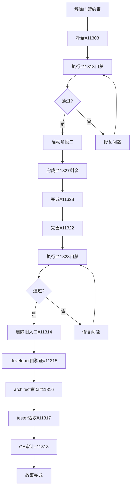

# AAF-113 任务完成情况总结

**生成日期**: 2026-09-22
**分析人**: Kiro

## 📊 整体进度

**29个技术任务状态分布**:
- ✅ **已完成**: 2个 (#11325, #11331)
- ⏳ **源码完成待门禁**: 23个
- [ ] **未开始**: 4个 (门禁与交付任务)

**需求覆盖**: 16个AC全部有实现，但未通过验收测试

**完成度评估**:
- 源码实现: ~85% (23/27个开发任务)
- 质量验证: 0% (所有门禁未启动)
- 需求覆盖: 100% (但未验证)

---

## 🚧 关键阻塞因素

### 1. 人为约束（最大阻塞）

根据tasks.md第35-36行和第74行:
> 本轮按人类明确指令只实现阶段一源码，测试仅调整因签名/依赖变更冲突的现有测试，不新增测试文件，不运行 test/check/lint/build

**影响**: 23个任务源码已完成但无法标记为✅

### 2. 外部依赖未解除

- **AAF-112**: #11205、#11206 人工质量门
- **AAF-115**: #11509 动态质量门
- **AAF-115**: 缺少 `DOMAIN_CONTEXT` Prompt层

**证据**:
```java
// 当前PromptLayerKind只有6层，没有业务域上下文层
public enum PromptLayerKind {
    CONSTITUTION,
    IDENTITY,
    INVOCATION_POLICY,
    ROLE,
    SKILL,
    PERSONA
    // 缺少: DOMAIN_CONTEXT
}
```

根据tasks.md第125-127行:
> ProjectContext实际按contextMode读取精确selected version、RAG Tool、
> 文档不可信上下文标记，仍等待AAF-115 DOMAIN_CONTEXT

### 3. 已知设计缺口

#### 缺口A: Publication stale标记 (#11312)

**问题**: `AigcWorkPublication`实体没有stale状态字段
```java
// 当前实体定义
public class AigcWorkPublication extends BaseEntity {
    private Long workId;
    private Long channelSpecVersionId;
    private String channelCode;
    // 缺少: stale字段或状态枚举
}
```

**影响**: 采用变化后，依赖旧manifest的已发布Publication无法被标记stale

**解决方案**: 需协调者决策（tasks.md第221-223行）
- 方案A: 新增状态值/字段（需要新增迁移，当前被禁止）
- 方案B: 后续版本补充（暂时记录为已知限制）

#### 缺口B: ProjectContext注入链路 (#11304)

**问题**: `ContentStudioProjectContextProvider.load()`当前无任何调用方

**影响**: 项目事实快照无法注入实际Assistant对话，项目Tool在Assistant Task内会fail closed

**解决方案**: 等待AAF-115新增`DOMAIN_CONTEXT`层后接入

---

## 📋 未完成任务清单

### 阶段一: CATALOG闭环（等待门禁）

**#11302 剩余范围** (lines 98-101):
- [ ] 目录项目创建入口事务边界评估
- [ ] ASSISTANT_GENERATED来源接入验证（依赖#11321）

**#11303 剩余范围** (line 112):
- [ ] webui图谱组件消费`sourceSemanticRole`等新字段

**#11313 阶段一门禁** (lines 433-439):
- [ ] 运行service/webui test、lint、typecheck、build
- [ ] 运行SQL静态检查
- [ ] 运行`pnpm check:affected`
- [ ] 验证CATALOG创建、ProjectGraph、readiness、candidate、积分
- [ ] 确认断线后从服务端恢复权威状态

**依赖**: #11301~#11312, #11324~#11326完成
**阻塞**: #11313未通过则不得启动阶段二

### 阶段二: CATALOG AI辅助（等待阶段一门禁）

**#11327 剩余范围** (lines 285-288):
- [ ] ProjectContext实际按contextMode读取精确selected version
- [ ] RAG Tool、文档不可信上下文标记（等待AAF-115 DOMAIN_CONTEXT）

**#11328 剩余范围** (line 309):
- [ ] Proposal目标成本服务端权威口径（取执行绑定estimatedCredits）
- [ ] 动态门禁（测试与`check:affected`）

**依赖**: #11313通过
**阻塞**: #11328未完成则不得启动阶段三

### 阶段三: Assistant完整接入（核心未完成）

**#11322 剩余范围**（从#11328移交）:
- [ ] 把`AigcApprovedGenerationTarget`冻结进`AigcExecutionRun.effectiveInput/contextSnapshot`
- [ ] Assistant执行链的可信projectId接线（当前恒为null）
- [ ] Proposal目标成本权威口径
- [ ] 专业媒体Tool适配#11309服务
- [ ] Assistant policy与用户权限的项目Tool可见性

**#11323 阶段三门禁** (lines 383-387):
- [ ] 验证CATALOG AI辅助、无目录Blueprint、对话协作
- [ ] 验证批量生成、manual/auto、外部等待和恢复
- [ ] 运行阶段三developer测试
- [ ] 运行最小真实链路smoke test
- [ ] 运行`pnpm check:affected`

**测试文件状态**:
```java
// ManualAAF11323IntegrationTest.java - 全部测试方法为TODO
@Disabled("手动执行 #11323 门禁测试 - 需要准备测试数据后移除此注解")
class ManualAAF11323IntegrationTest {
    @Test void testBlueprintProposalSubmission() { /* TODO */ }
    @Test void testInspectProjectSemantics() { /* TODO */ }
    @Test void testRecordProjectTextCandidate() { /* TODO */ }
    @Test void testRecordProjectDocumentCandidate() { /* TODO */ }
    @Test void testSubmitApprovedGenerationAction() { /* TODO */ }
}
```

**依赖**: #11304~#11308, #11321~#11322, #11327~#11328
**阻塞**: #11323未通过则不得删除旧入口

### 阶段四: 一次性定时任务（源码完成）

**#11319, #11320** - 源码已完成，等待门禁验证

### 旧入口删除（未启动）

**#11314 一次性切换旧入口** (lines 441-449):
- [ ] 原子切换UI、Assistant Tool和动作权限
- [ ] 拒绝旧入口新请求
- [ ] 盘点在途root/child执行并按策略完成或取消
- [ ] 结清每个在途执行的reserved、settled、refunded
- [ ] 输出对账报告
- [ ] 删除旧服务特判、seed、binding、调用方和对应测试
- [ ] 全仓搜索确认无可达旧入口、fallback、dual-write

**依赖**: #11323通过
**覆盖**: AC-14

### 交付验证链（未启动）

**#11315 developer自验证** (lines 451-458):
- [ ] 运行受影响项目test、lint、typecheck、build
- [ ] 运行`pnpm check:affected`（必须全绿）
- [ ] 检查源码中已删除旧入口引用
- [ ] 在dev-log.md记录所有任务结果
- [ ] 汇总迁移dry-run、单元测试、构建证据

**#11316 architect审查** (lines 460-469):
- [ ] 对照requirement、design、源码、迁移审查AC-01至AC-16
- [ ] 检查聚合边界、模块依赖、不变量
- [ ] 对Major-3作出ProjectSemanticDefinition废弃来源决策
- [ ] 对Major-4作出candidate provenance决策
- [ ] 输出review.md（blocker必须归零）
- [ ] 再次确认`pnpm check:affected`全绿

**#11317 tester验收** (lines 472-479):
- [ ] 为AC-01至AC-16编写或更新独立验收测试
- [ ] 覆盖并发修订、图无环、readiness、双入口
- [ ] 增加服务重启、事件丢失、重复事件场景
- [ ] 运行`pnpm acceptance:affected`
- [ ] 输出test-report.md（覆盖矩阵+结果+缺陷链接）

**#11318 QA过程审计** (lines 482-489):
- [ ] 核对文档完整且版本一致
- [ ] 核对证据有效
- [ ] 检查每条AC有设计、实现、测试和结果证据
- [ ] 质量门控: blocker=0且major≤2
- [ ] 通过后更新任务状态和交付记录

---

## 🎯 优先级与建议

### 立即可做（不违反人类约束）

#### 1. 补全#11303剩余范围（30分钟）

**任务**: 扩展webui图谱组件消费新字段

```typescript
// 需要同步的类型
interface AigcProjectRelationVO {
  // ... existing fields
  sourceSemanticRole?: string;
  targetSemanticRole?: string;
  sourceOutputContract?: string;
  targetOutputContract?: string;
}
```

**文件位置**: `apps/webui/src/features/aigc/types/project.ts`

#### 2. 准备#11313门禁执行清单（1小时）

**检查清单**:
- [ ] 确认阶段一11个任务的源码完整性
- [ ] 列出需要运行的测试命令
- [ ] 准备SQL静态检查工具
- [ ] 准备`pnpm check:affected`命令

**输出**: 门禁执行脚本

#### 3. 完善ManualAAF11323IntegrationTest（4小时）

**实现5个TODO测试方法**:
```java
@Test void testBlueprintProposalSubmission() {
    // 1. 构造ToolInvocation（包含taskId, executionId）
    // 2. 准备projectSpecification, objectSpecs, relationSpecs
    // 3. 调用SubmitAssistantBlueprintProposalToolHandler.invoke()
    // 4. 断言返回结果包含proposalId
    // 5. 查询数据库验证持久化数据
}
// ... 其他4个测试
```

#### 4. 文档完善（2小时）

**需要准备的文档**:
- [ ] dev-log.md框架（按#113NN标题组织）
- [ ] review.md模板（blocker/major/minor分类）
- [ ] test-report.md模板（AC覆盖矩阵）

### 等待人类决策

#### 决策A: Publication stale方案（#11312）

**选项**:
1. **新增状态字段** - 需要新增迁移文件（当前被禁止）
2. **记录为已知限制** - 本轮不实现，后续版本补充
3. **使用版本比对** - 运行时动态判断（性能影响）

**建议**: 选择方案2，在tasks.md和review.md中记录为已知限制

#### 决策B: 解除"不运行门禁"约束

**当前约束**（tasks.md第35-36行）:
> 不运行 test/check/lint/build

**影响**:
- 23个任务无法验证
- 门禁#11313/#11323无法执行
- 故事无法完成

**建议**: 解除约束，按阶段执行门禁

#### 决策C: AAF-115 DOMAIN_CONTEXT层

**问题**: 跨story依赖，AAF-113无法自行解决

**影响**:
- #11304项目上下文无法注入对话
- #11327文档RAG Tool无法接入
- #11322项目Tool在Assistant Task内fail closed

**建议**: 
1. 与AAF-115协调排期
2. 或临时方案：通过用户消息通道传递（污染输入，需评估）

---

## 📈 完成路径建议

### 路径一: 全链路验证（推荐）



**时间估算**: 2-3周（假设无大问题）

### 路径二: 部分验证（折中方案）

**范围**: 只验证阶段一CATALOG闭环

**步骤**:
1. 补全#11303剩余范围
2. 执行#11313门禁
3. 记录阶段一验证结果
4. 阶段二~四作为"源码完成，待未来验证"

**优点**: 快速完成最小可验证闭环
**缺点**: AC-02、AC-06~AC-10、AC-12、AC-14、AC-16未验证

### 路径三: 记录现状（最小方案）

**操作**:
1. 补全#11303剩余范围
2. 完善文档（dev-log、已知限制）
3. 标记故事为"源码85%完成，待门禁解除后验证"

**适用场景**: 人类决策暂时不解除约束

---

## 🔍 故事完成定义检查

根据tasks.md第569-583行，AAF-113完成需满足：

| 完成标准 | 当前状态 | 缺口 |
|---------|---------|------|
| AC-01至AC-16均有实现和验收证据 | ⚠️ 有实现，无验收 | 需要#11317 |
| 文本/文档/图像端到端真实跑通 | ⚠️ 源码完成，未验证 | 需要#11313 |
| 音视频按专业Tool可用性进入同一合同 | ✅ 源码完成 | - |
| AigcProjectConfigSnapshot不可变 | ✅ 源码完成 | - |
| ProjectRevision、初始化字段真理源正确 | ✅ 源码完成 | - |
| parentId、relation layer、对象语义正确 | ✅ 源码完成 | - |
| canonical TaskPlan、readiness断线可恢复 | ⚠️ 源码完成，未验证 | 需要#11323 |
| 实际积分来自账本且关联链完整 | ✅ 源码完成 | - |
| RUN_ONCE时间点可幂等创建Assistant Task | ✅ 源码完成 | - |
| 不存在用户cron、第二scheduler | ✅ 已遵守 | - |
| 旧批量入口不可达、在途结清 | ❌ 未开始 | 需要#11314 |
| `pnpm check:affected`全绿 | ❌ 未运行 | 需要#11315 |
| `pnpm acceptance:affected`全绿 | ❌ 未运行 | 需要#11317 |
| dev-log/review/test-report完整 | ❌ 未完成 | 需要#11315~#11317 |
| blocker=0且major≤2 | ❌ 未审查 | 需要#11316 |

**结论**: 当前**不满足完成定义**

---

## 📝 建议采取的下一步行动

### 本周可完成（假设解除约束）

1. **Day 1-2**: 补全#11303 + 准备#11313门禁 + 完善测试
2. **Day 3**: 执行#11313门禁，修复问题
3. **Day 4-5**: 完成#11327/#11328剩余范围

### 需要明确的决策

请人类明确以下决策：

1. **是否解除"不运行门禁"约束？**
   - 影响：23个任务的验证、门禁执行、故事完成

2. **Publication stale标记如何处理？**
   - 选项：新增字段/记录限制/动态判断

3. **AAF-115 DOMAIN_CONTEXT层的排期？**
   - 影响：ProjectContext注入、#11304/#11327完整性

4. **是否接受"部分验证"方案？**
   - 即：只验证阶段一，阶段二~四标记为"待验证"

---

## 附录：关键文件位置

### 文档
- 需求：`docs/task/v0.13/AAF-113/requirement.md`
- 设计：`docs/task/v0.13/AAF-113/design.md`
- 任务：`docs/task/v0.13/AAF-113/tasks.md`
- UI设计：`docs/task/v0.13/AAF-113/ui-design.md`

### 核心代码
- Blueprint编译器：`apps/service/.../aigc/project/blueprint/AigcCatalogBlueprintCompiler.java`
- 项目物化器：`apps/service/.../aigc/project/service/AigcProjectMaterializer.java`
- Readiness服务：`apps/service/.../aigc/project/service/AigcProjectService.java`
- 定时任务：`apps/service/.../aigc/project/service/AigcProjectScheduleService.java`

### 测试
- 阶段三门禁测试：`apps/service/.../aigc/project/ManualAAF11323IntegrationTest.java`
- 前端项目页测试：`apps/webui/src/app/studio/projects/[id]/page.wiring.test.ts`

### 待补充类型
- 前端项目类型：`apps/webui/src/features/aigc/types/project.ts`

---

**生成时间**: 2026-09-22
**下次更新**: 等待人类决策后更新
